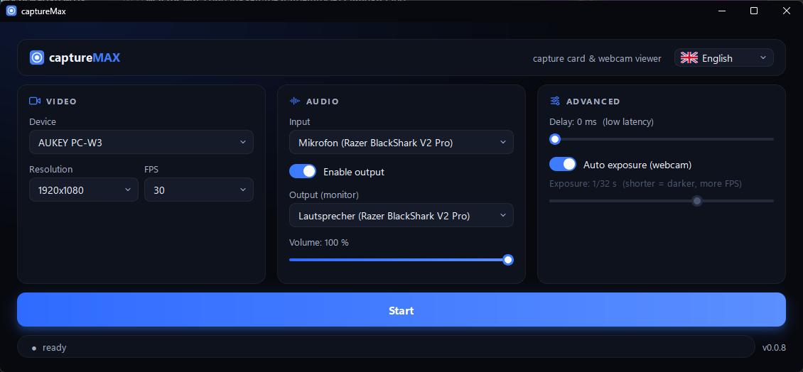
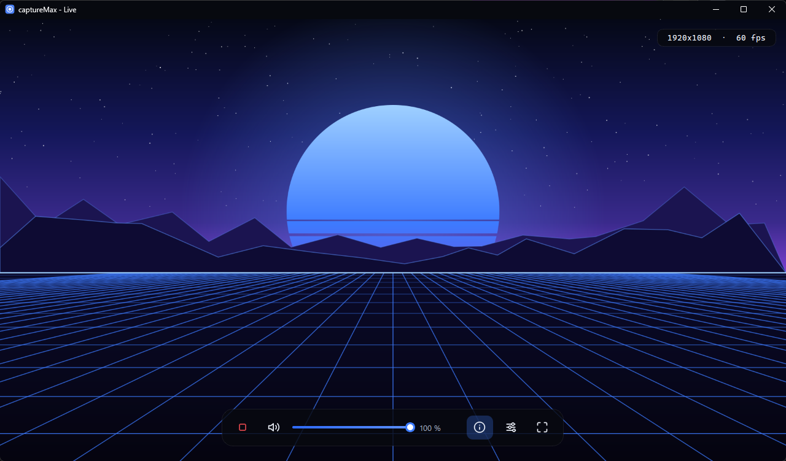

<p align="center"></p>

<h1 align="center">captureMax</h1>

<p align="center">Low-latency live viewer for capture cards and webcams on Windows, macOS and Linux. No OBS, no VLC, one app.</p>





## Features

- **Live video** from any capture card or webcam the OS knows. Resolution and FPS lists come from the device's
  real formats, and compressed formats (MJPG) are preferred automatically so USB devices reach full frame rate.
- **Audio monitoring**: plays the capture card's audio (48 kHz stereo) on any output. Volume and mute work live.
  The audio input follows the video device automatically.
- **Hover bar**: move the mouse over the live window for stop, mute, volume, info (resolution and live fps, top
  right), settings and fullscreen. It fades out when the mouse rests.
- **Fullscreen** with the hover-bar button, `F11` or a double-click. No window frame, so a Discord window share
  shows only the picture.
- **Settings while live**: the gear opens and closes the settings over the running stream. *Save* restarts with
  the new settings; closing without saving asks before discarding changes.
- **Low latency** by default, with an optional video delay (0–2000 ms) to line up picture and sound.
- **Webcam tuning**: manual exposure for higher frame rates in low light (Windows and Linux). On Windows the
  exposure controls only appear for webcams; capture cards don't have any.
- **Update check**: on start the app looks for a newer release and offers to open the download page. The installed
  version is shown bottom right.
- **German and English UI**: follows the system language, switchable in the header.
- Dark title bars, remembers all settings.

## Download

Grab the build for your system from the [latest release](../../releases/latest):

| System | File | First start |
|---|---|---|
| Windows 10/11 | `captureMax-windows.exe` | Run it. SmartScreen may warn about an unknown publisher: *More info → Run anyway*. |
| macOS 12+ (Apple Silicon) | `captureMax-macos.zip` | Unzip, move to Applications, then **right-click → Open** once (the app is not notarized). Allow camera and microphone access. |
| Linux (x86-64, glibc 2.35+) | `captureMax-linux.tar.gz` | `tar -xzf captureMax-linux.tar.gz && ./captureMax`. Needs `libxcb-cursor0` and `libpulse0` (or PipeWire's Pulse layer). |

## Usage

1. **VIDEO**: pick the device, resolution and FPS.
2. **AUDIO**: pick the input (usually the capture card, or *Off*) and your speakers or headset.
3. Click **Start**. `F11` or a double-click toggles fullscreen; `Esc` leaves fullscreen, or stops when windowed.
   Closing the live window stops too.

The status bar (and the info overlay) shows the real resolution and frame rate.

## Run from source

Python 3.12:

```sh
python -m venv .venv
.venv/bin/pip install -r requirements.txt        # Windows: .venv\Scripts\pip ...
.venv/bin/python capturemax.py
```

## Build locally

```sh
pip install pyinstaller==6.22.3 pillow
pyinstaller --noconfirm captureMax.spec
```

The output goes to `dist/`: `captureMax.exe` on Windows, `captureMax.app` on macOS, `captureMax` on Linux.
PyInstaller can't cross-compile, so each system builds its own version.

## Releasing

[`.github/workflows/release.yml`](.github/workflows/release.yml) builds and smoke-tests all three systems on every
push and pull request. Pushing a version tag also publishes a GitHub release with the three downloads and generated
notes:

```sh
git tag v0.0.8
git push origin v0.0.8
```

The workflow writes the tag into `VERSION` in `capturemax.py` (source runs show `dev` and skip the update check).
Versions follow [semantic versioning](https://semver.org) (`vMAJOR.MINOR.PATCH`). `main` and `v*` tags are
protected by rulesets: changes from others come in as pull requests that need green builds.

## Contributing

Bug reports, ideas and pull requests are welcome, see [CONTRIBUTING.md](CONTRIBUTING.md). Questions go to
[Discussions](../../discussions), security issues to [SECURITY.md](SECURITY.md).

## Troubleshooting

| Problem | Fix |
|---|---|
| Webcam stays around 20 fps | Turn **Auto exposure** off and lower **Exposure** (for example 1/64 s). The picture gets darker, but the frame rate goes up. |
| "No picture from device" | Another app (OBS, Teams, Discord) is using the device. Close it, or use that app's virtual camera. |
| macOS shows a black picture | Allow camera access in *System Settings → Privacy & Security → Camera*. |
| Exposure control greyed out | macOS offers no exposure control for USB cameras. Some Linux cameras don't either. |
| Exposure controls missing (Windows) | The device reports no camera control, so it's treated as a capture card. Capture cards pass the source's picture through and have no exposure. |
| Audio and video out of sync | Raise **Delay** until they match. |

## License

[MIT](LICENSE)
